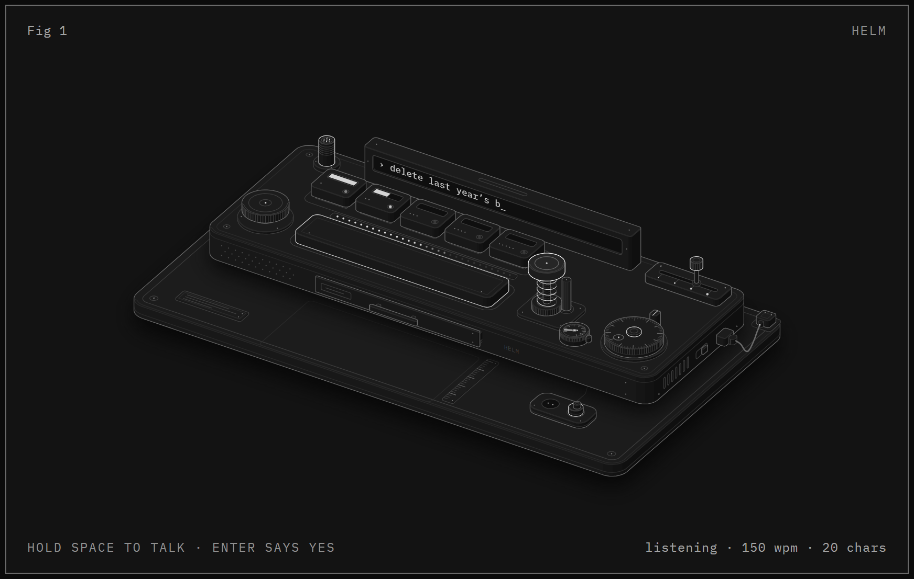

# Helm

A concept keyboard for a desk where you talk to your computer and software agents do the work.



**See it running**

- Live page: https://ashish-soni08-helm-keyboard.static.hf.space
- The same page on Hugging Face: https://huggingface.co/spaces/ashish-soni08/helm-keyboard
- The original on claude.ai: https://claude.ai/artifact/47tJNiR1vxTN5pNncyzA1R

The page is an interactive model you can drive from your own keyboard, followed by a build brief with a parts list, a six-stage build path, the messages between board and software, and the open risks.

## The idea

Keep the verbs, drop the alphabet. Speech runs at about 150 words a minute and typing at about 40, so sentences go to the voice. Six keys stay, because none of them was ever a letter.

| Old key | New control | What it does |
| --- | --- | --- |
| Space | Talk bar | Held down, a microphone stalk rises out of the deck and listens. Released, the stalk drops below the surface. |
| Enter | Consent key | Approves what an agent asks to do. Its spring is wound tighter as the stakes rise, from 0.5 N to 6 N. |
| Backspace | Undo wheel | Turns one notch for every act an agent completes. Turning it back reverses the last act or refuses a request. |
| Arrows | Leash lever | Four stops: watch, ask, act, run. Sets how much an agent may do before it must ask. |
| Escape | Halt button | A latching mushroom button. Every agent holds still until it is released. |
| Caps Lock | Letter drawer | A drawer holding the 26 letters, for names, passwords and symbols. |

Five agent keys sit above the talk bar, one per running agent. A key rises when its agent needs a yes.

## Driving the model

Click the figure, then use your keyboard.

| Key | Action |
| --- | --- |
| Hold Space | Talk. The model speaks one of five scripted phrases, since it has no real microphone. |
| Enter | Say yes to the agent that is asking |
| Backspace | Send a request back, or undo the last completed act |
| Left and right arrows | Shorten or lengthen the leash |
| Escape | Halt and release |
| Caps Lock | Open the letter drawer, then type an instruction and press Enter |
| 1 to 5 | Look at an agent |

Try opening the drawer and typing `delete everything`. The consent key winds up to 5.7 N.

On a phone, the buttons under the figure do the same jobs.

## Status

Helm is a design concept with a working model. There is no CAD, circuit board, firmware or physical prototype. The stakes scale and the forces are an invented model that the page follows consistently. They are not measurements.

The build brief was written for NuPhy. This project is not affiliated with NuPhy or endorsed by them.

## What is in this repository

| File | What it is |
| --- | --- |
| `index.html` | The whole page in one file. Open it in any browser. This is what the Hugging Face Space serves. |
| `build.mjs` | Builds the model and the page. Every dimension and the stakes model live here. |
| `brief.mjs` | The text of the build brief. |
| `helm.html`, `helm-light.html` | The same page fixed to the dark and light themes. |
| `helm-artifact.html` | The page without a document shell, as published on claude.ai. |
| `space/README.md` | The card for the Hugging Face Space. |

## Rebuilding

The build needs Node.js and the [anatomy kit](https://github.com/wheresryan22/anatomy), which draws the isometric figure. The build looks for the kit at `~/.claude/skills/anatomy`, or wherever `ANATOMY_KIT` points.

```sh
node build.mjs --artifact   # helm.html, helm-artifact.html and index.html
node build.mjs --light      # helm-light.html
```

## Credits

- The figure is drawn with the [anatomy kit](https://github.com/wheresryan22/anatomy) by Ryan, used under the MIT licence. The built pages include the kit's drawing code. Its licence is in `licenses/anatomy-LICENSE`.
- Type is IBM Plex Sans and IBM Plex Mono, loaded from Google Fonts.
- Designed and built by Ashish Soni with Claude Code.

No licence has been chosen for Helm itself yet, so all rights are reserved for now.
